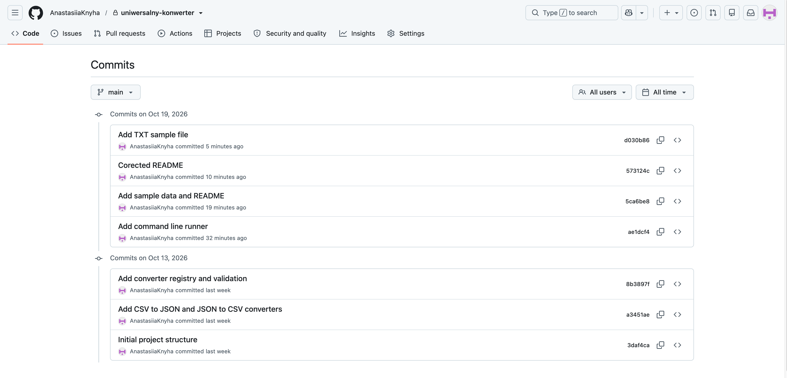
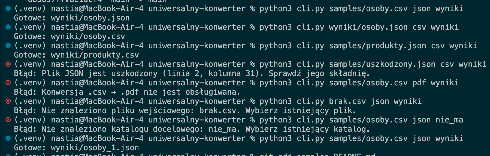

# Raport z etapu 1 (Lab 2)

Anastasiia Knyha, nr albumu 106230
19 października 2026

## Co zrobiłam

W tym etapie zrobiłam podstawę programu. Program umie zamienić plik CSV na JSON i plik JSON na CSV. Na razie uruchamia się go z terminala

Przygotowałam też pliki testowe w folderze samples i założyłam repozytorium na GitHubie. Zaplanowałam wszystkie 6 konwersji, które będą w gotowym programie. Lista jest w README.

## Jak zbudowany jest kod

Podzieliłam kod na kilka plików, żeby każdy robił jedną rzecz.

| Plik | Co robi |
|---|---|
| konwerter/errors.py | własny błąd ConversionError z komunikatem dla użytkownika |
| konwerter/data.py | funkcje csv_to_json i json_to_csv |
| konwerter/registry.py | słownik REGISTRY z parami formatów, sprawdzanie danych i funkcja execute |
| cli.py | uruchamianie programu z terminala |

Najważniejszy jest słownik REGISTRY. Każda para formatów ma w nim swoją funkcję. Żeby dodać nową konwersję, wystarczy dopisać jedną linię w słowniku. Dzięki temu GUI nie musi wiedzieć nic o formatach, tylko pyta słownik, co jest dostępne.

## Historia w GitHub

| Data | Commit |
|---|---|
| 13.10.2026 | Initial project structure |
| 13.10.2026 | Add CSV to JSON and JSON to CSV converters |
| 13.10.2026 | Add converter registry and validation |
| 19.10.2026 | Add command line runner |
| 19.10.2026 | Add sample data and README |
| 19.10.2026 | Corected README |
| 19.10.2026 | Add TXT sample file |

## Testy

Wszystkie testy zrobiłam w terminalu.

| Nr | Co sprawdzam | Komenda | Wynik | Działa |
|---|---|---|---|---|
| 1 | zamiana CSV na JSON | python3 cli.py samples/osoby.csv json wyniki | powstał plik wyniki/osoby.json | tak |
| 2 | czy wynik da się znowu odczytać | python3 cli.py wyniki/osoby.json csv wyniki | powstał plik wyniki/osoby.csv, taki sam jak oryginał | tak |
| 3 | JSON z różnymi polami i null | python3 cli.py samples/produkty.json csv wyniki | powstał plik wyniki/produkty.csv, brakujące pola są puste | tak |
| 4 | zepsuty plik JSON | python3 cli.py samples/uszkodzony.json csv wyniki | komunikat, że plik jest uszkodzony (linia 2, kolumna 31) | tak |
| 5 | nieobsługiwana para | python3 cli.py samples/osoby.csv pdf wyniki | komunikat, że konwersja CSV na PDF nie jest obsługiwana | tak |
| 6 | plik nie istnieje | python3 cli.py brak.csv json wyniki | komunikat, że nie znaleziono pliku | tak |
| 7 | folder nie istnieje | python3 cli.py samples/osoby.csv json nie_ma | komunikat, że nie znaleziono folderu | tak |
| 8 | plik wynikowy już istnieje | python3 cli.py samples/osoby.csv json wyniki | powstał nowy plik wyniki/osoby_1.json, stary nie został nadpisany | tak |

## Dlaczego takie testy

Testy 1, 2 i 3 sprawdzają, czy obie konwersje działają i czy wynik da się znowu otworzyć. W pliku osoby.csv są polskie znaki, puste pola i przecinek w cudzysłowie, bo przy takich rzeczach najłatwiej o błąd. W pliku produkty.json obiekty mają różne pola i jest wartość null, żeby sprawdzić, czy program sobie z tym poradzi.

Test 4 sprawdza, czy zepsuty plik nie wyłącza programu. Program ma pokazać zrozumiały komunikat i powiedzieć, gdzie jest błąd.

Testy 5, 6 i 7 sprawdzają walidację. Program najpierw sprawdza plik, format i folder, a dopiero potem robi konwersję.

Test 8 sprawdza, czy program nie nadpisuje pliku, który już jest. Zamiast tego dodaje numer do nazwy.

## Źródła i narzędzia

Użyłam tylko modułów wbudowanych w Pythona, czyli csv, json, pathlib, os i sys.

Korzystałam z dokumentacji Pythona
https://docs.python.org/3/library/csv.html
https://docs.python.org/3/library/json.html

Korzystałam z pomocy AI (Claude). Claude pomógł mi zrobić plan realizacji każdego etapu i rozpisać zadania na każdy etap. Pomagał mi też poprawiać kod w miejscach, gdzie nie działał, oraz szukać informacji o błędach i o tym, jak je naprawić.