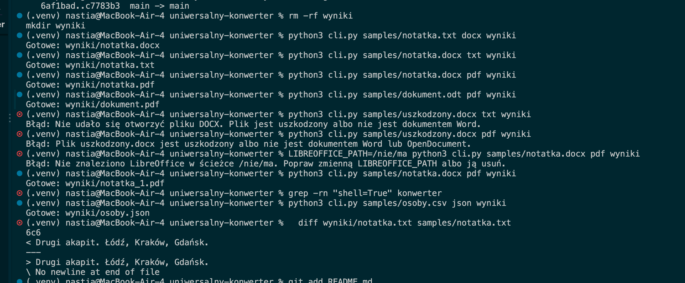

# Raport z etapu 2 (Lab 3)

Anastasiia Knyha, nr albumu 106230
26 października 2026

Repozytorium https://github.com/AnastasiiaKnyha/uniwersalny-konwerter

## Co zrobiłam

W tym etapie dodałam cztery nowe konwersje. Program umie teraz zamienić TXT na DOCX, DOCX na TXT oraz DOCX i ODT na PDF. Razem z CSV i JSON z poprzedniego etapu program obsługuje już wszystkie 6 zaplanowanych konwersji z trzech grup.

Dodałam też plik requirements.txt z potrzebną biblioteką, nowe pliki testowe i zaktualizowałam README.

## Jakie narzędzia wybrałam i dlaczego

Do plików DOCX użyłam biblioteki python-docx. Jest prosta, dobrze opisana i działa bez dodatkowych programów. Umie odczytać akapity z dokumentu i stworzyć nowy dokument z tekstu.

Do zamiany na PDF użyłam programu LibreOffice. Jest darmowy, działa na macOS, Windowsie i Linuxie i umie zapisywać dokumenty jako PDF bez otwierania okna. Python nie ma prostej biblioteki, która dobrze zamienia DOCX i ODT na PDF, dlatego program uruchamia LibreOffice w tle.

## Jak działa uruchamianie LibreOffice

Program najpierw szuka LibreOffice. Sprawdza zmienną LIBREOFFICE_PATH, potem ścieżkę systemową, a na końcu typowe miejsca instalacji na różnych systemach. Jeśli go nie znajdzie, pokazuje komunikat ze stroną, z której można go pobrać.

LibreOffice jest uruchamiany przez subprocess.run. Komendę podaję jako listę, bez shell=True, więc nazwy plików ze spacjami działają poprawnie i jest bezpieczniej. Program sprawdza kod zakończenia. Zero oznacza sukces, każda inna liczba oznacza błąd. Sprawdza też, czy plik PDF naprawdę powstał. Jest też limit czasu 120 sekund, żeby program się nie zawiesił.

Przed uruchomieniem LibreOffice program sprawdza, czy plik DOCX lub ODT nie jest uszkodzony. Bez tego LibreOffice otwierał zepsuty plik jak zwykły tekst i robił z niego PDF.

## Nowe pliki w kodzie

| Plik | Co robi |
|---|---|
| konwerter/text.py | funkcje txt_to_docx i docx_to_txt |
| konwerter/office.py | szukanie LibreOffice i zamiana DOCX i ODT na PDF |
| requirements.txt | lista bibliotek do zainstalowania |

W słowniku REGISTRY dopisałam cztery nowe linie. Reszty programu nie musiałam zmieniać.

## Historia w GitHub

| Data | Commit |
|---|---|
| 26.10.2026 | Add requirements file |
| 26.10.2026 | Add TXT to DOCX and DOCX to TXT converters |
| 26.10.2026 | Add DOCX and ODT to PDF converters with LibreOffice |
| 26.10.2026 | Add DOCX and ODT sample files |
| 26.10.2026 | Update README for Lab 3 |

## Testy

Wszystkie testy zrobiłam ręcznie w terminalu.

| Nr | Co sprawdzam | Komenda | Wynik | Działa |
|---|---|---|---|---|
| 1 | zamiana TXT na DOCX | python3 cli.py samples/notatka.txt docx wyniki | powstał plik wyniki/notatka.docx z trzema akapitami i polskimi znakami | tak |
| 2 | zamiana DOCX na TXT | python3 cli.py samples/notatka.docx txt wyniki | powstał plik wyniki/notatka.txt, taki sam jak oryginał | tak |
| 3 | zamiana DOCX na PDF | python3 cli.py samples/notatka.docx pdf wyniki | powstał plik wyniki/notatka.pdf | tak |
| 4 | zamiana ODT na PDF | python3 cli.py samples/dokument.odt pdf wyniki | powstał plik wyniki/dokument.pdf | tak |
| 5 | zepsuty DOCX na TXT | python3 cli.py samples/uszkodzony.docx txt wyniki | komunikat, że nie udało się otworzyć pliku DOCX | tak |
| 6 | zepsuty DOCX na PDF | python3 cli.py samples/uszkodzony.docx pdf wyniki | komunikat, że plik jest uszkodzony | tak |
| 7 | brak LibreOffice | LIBREOFFICE_PATH=/nie/ma python3 cli.py samples/notatka.docx pdf wyniki | komunikat, że nie znaleziono LibreOffice, z instrukcją | tak |
| 8 | plik wynikowy już istnieje | python3 cli.py samples/notatka.docx pdf wyniki | powstał nowy plik wyniki/notatka_1.pdf | tak |
| 9 | brak shell=True w kodzie | grep -rn "shell=True" konwerter | brak wyników | tak |
| 10 | stare konwersje dalej działają | python3 cli.py samples/osoby.csv json wyniki | powstał plik wyniki/osoby.json | tak |

## Dlaczego takie testy

Testy 1, 2, 3 i 4 sprawdzają wszystkie nowe konwersje. Plik notatka.txt ma polskie znaki i kilka akapitów, żeby sprawdzić, czy akapity i znaki się nie psują. Po zamianie TXT na DOCX i z powrotem tekst jest taki sam jak na początku.

Testy 5 i 6 sprawdzają, czy zepsuty plik nie wyłącza programu i czy komunikat jest zrozumiały.

Test 7 sprawdza, co się dzieje, gdy nie ma LibreOffice. Nie musiałam go odinstalowywać, wystarczyło podać złą ścieżkę w zmiennej LIBREOFFICE_PATH tylko dla jednej komendy.

Test 8 sprawdza, czy program nie nadpisuje istniejącego pliku także przy PDF.

Test 9 pokazuje, że w kodzie nie ma shell=True.

Test 10 sprawdza, czy nowe zmiany nie zepsuły konwersji z poprzedniego etapu.

## Źródła i narzędzia

Użyłam biblioteki python-docx i programu LibreOffice. Z Pythona użyłam modułów subprocess, shutil, tempfile, zipfile, os i pathlib.

Korzystałam z dokumentacji
https://python-docx.readthedocs.io/
https://help.libreoffice.org/latest/en-US/text/shared/guide/start_parameters.html
https://docs.python.org/3/library/subprocess.html

Korzystałam z pomocy AI (Claude). Claude pomógł mi zrobić plan realizacji każdego etapu i rozpisać zadania na każdy etap. Pomagał mi też poprawiać kod w miejscach, gdzie nie działał, oraz szukać informacji o błędach i o tym, jak je naprawić.